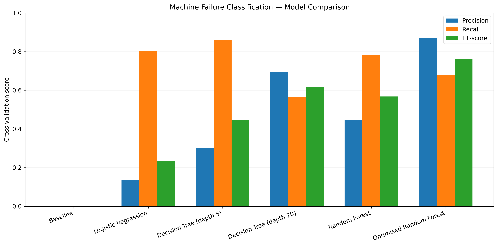
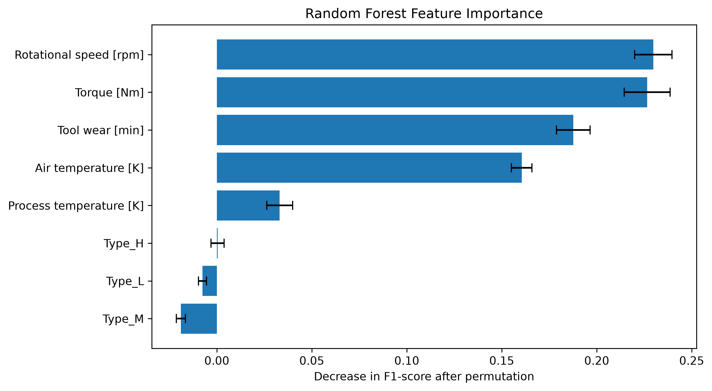
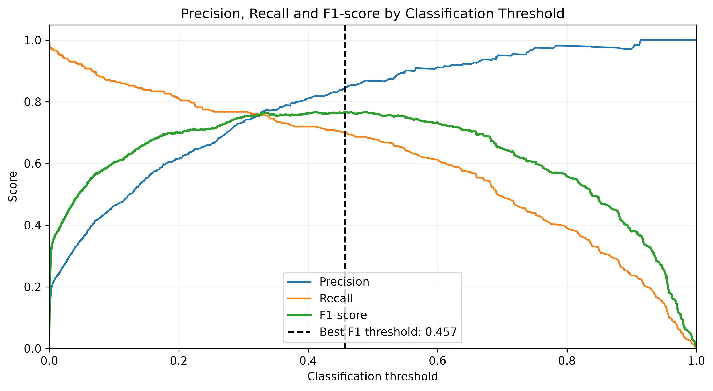

# Predictive Maintenance Using Machine Learning

## Project Overview

This project investigates the use of supervised machine learning to classify industrial machine failures based on operating conditions.

Using the synthetic AI4I 2020 Predictive Maintenance dataset, I explored relationships between sensor measurements and machine failure, trained and compared several classification models, and investigated how hyperparameter optimisation affects predictive performance.

The project focuses particularly on the challenges of class imbalance and the trade-off between identifying genuine failures and generating unnecessary maintenance warnings.

## Dataset

The AI4I 2020 Predictive Maintenance dataset contains 10,000 observations of simulated industrial machinery operating conditions.

The analysis uses the following input features:

- Air temperature and process temperature
- Rotational speed
- Torque
- Tool wear
- Machine product type

Only 339 observations (3.39%) represent machine failures, creating a substantially imbalanced classification problem.

The dataset was divided into stratified training (80%) and testing (20%) subsets. Failure-type indicators and identifiers were excluded from model inputs to avoid target leakage.

## Methodology

The project was developed in Python using Pandas, NumPy, Matplotlib and scikit-learn.

The analysis consisted of:

1. Exploratory data analysis to investigate failure patterns across operating conditions.
2. Training a baseline classifier, Logistic Regression, Decision Trees and Random Forests.
3. Evaluating models using precision, recall, F1-score and stratified five-fold cross-validation.
4. Investigating how Decision Tree depth affects model performance.
5. Examining feature importance using permutation analysis.
6. Optimising Random Forest hyperparameters using RandomizedSearchCV.
7. Analysing how classification thresholds affect failure detection and false alarms.

F1-score was the primary model comparison metric, while precision and recall were examined separately to understand the operational trade-offs.

## Results

The following results represent mean five-fold cross-validation performance on the training subset.

| Model | Precision | Recall | F1-score |
|---|---:|---:|---:|
| Baseline | 0.000 | 0.000 | 0.000 |
| Logistic Regression | 0.137 | 0.804 | 0.235 |
| Decision Tree (depth 5) | 0.304 | 0.860 | 0.449 |
| Decision Tree (depth 20) | 0.694 | 0.565 | 0.619 |
| Random Forest | 0.447 | 0.782 | 0.568 |
| Optimised Random Forest | 0.869 | 0.679 | 0.761 |



The optimised Random Forest achieved the highest cross-validation F1-score of 0.761, compared with 0.568 for the original configuration.

This improvement was primarily associated with increased precision, although recall decreased. The shallower Decision Tree achieved the highest recall, demonstrating that the preferred model depends on the relative importance of missed failures and false alarms.

### Feature Importance

Permutation importance analysis of the initial Random Forest identified rotational speed, torque and tool wear as influential predictors.



These results were broadly consistent with exploratory findings suggesting non-linear relationships between operating conditions and machine failure.

### Classification Threshold Analysis

The optimised Random Forest was also evaluated using different classification thresholds.

An F1-maximising threshold of approximately 0.457 was identified using out-of-fold predictions, producing precision of 0.848, recall of 0.701 and F1-score of 0.768.



Reducing the threshold increased the proportion of failures detected at the expense of some precision, illustrating how model decisions can be adjusted according to operational priorities.

## Practical Implications

In industrial applications, the consequences of missed failures and false alarms may differ significantly.

For example, a missed failure might hypothetically result in £50,000 of repairs and downtime, compared with £500 for an unnecessary inspection. Under these assumptions, prioritising recall or minimising expected maintenance costs could be more appropriate than maximising F1-score alone.

The best model therefore depends on the practical requirements of the application rather than any single performance metric.

## Limitations

The AI4I dataset is synthetic and represents simulated failure conditions rather than observations from deployed industrial equipment. The project classifies failure outcomes; it does not predict remaining useful life or the time until a future breakdown.

The optimised model's cross-validation results may be optimistic because the same validation folds were used for hyperparameter selection. The classification threshold was also selected using training-data predictions.

Additionally, the test set was examined during initial model development and therefore does not constitute a completely untouched final evaluation set. Independent validation would be needed before making claims about real-world performance.

## Repository Structure

```text
predictive-maintenance-ml/
├── data/
│   └── ai4i2020.csv
├── notebooks/
│   ├── 01_exploratory_analysis.ipynb
│   └── 02_model_training.ipynb
├── figures/
│   ├── feature_importance.png
│   ├── model_comparison.png
│   └── threshold_analysis.png
├── .gitignore
├── requirements.txt
└── README.md
```

## Reproducing the Analysis

Clone the repository:

```bash
git clone https://github.com/matthewduke36/predictive-maintenance-ml.git
cd predictive-maintenance-ml
```

Create and activate a virtual environment:

```bash
python3 -m venv .venv
source .venv/bin/activate
```

Install the dependencies:

```bash
python -m pip install -r requirements.txt
```

Open and run the notebooks in order:

1. `notebooks/01_exploratory_analysis.ipynb`
2. `notebooks/02_model_training.ipynb`

The analysis uses fixed random seeds to support reproducibility.

## Data Source

AI4I 2020 Predictive Maintenance Dataset — UCI Machine Learning Repository.

https://archive.ics.uci.edu/dataset/601/ai4i+2020+predictive+maintenance+dataset
